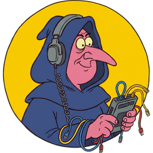
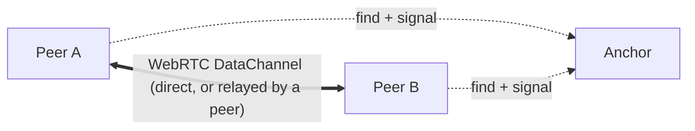

<p align="center"></p>
<p align="center"><a href="https://corvax.sloev.workers.dev">Homepage</a> · <a href="https://www.npmjs.com/package/@sloev/corvax">npm</a> · <a href="https://buymeacoffee.com/sloev">Buy me a coffee ☕</a></p>

# CORVAX

Find any peer by its key or by a topic, from any runtime, and open an encrypted WebRTC DataChannel to it: direct when possible, otherwise relayed through another peer.

- **Addresses are keys** (Ed25519, 52 chars). Nothing to register, and they never expire.
- **No central server required.** Anchors are ordinary peers that others can reach; anyone can run one, none is trusted, and they only introduce peers (never in the data path).
- **Topics:** leased, signed presence plus short best-effort broadcasts.
- **Zero runtime dependencies, no build step.** Runs in browsers, Node ≥ 22, Bun and Deno.



## Use

Browsers, no build step:

```html
<script type="module">
  import { Peer } from 'https://cdn.jsdelivr.net/npm/@sloev/corvax@0.1/dist/corvax.min.js'
</script>
```

Node ≥ 22, Bun, Deno and bundlers:

```sh
npm i @sloev/corvax   # then: import { Peer } from '@sloev/corvax'   (Deno: 'npm:@sloev/corvax')
```

Every green push to `main` releases `0.1.N` (npm, plus a GitHub release with the bundle; the 10 newest are kept, `latest` tags the newest). `@sloev/corvax@0.1` follows them; pin with `@sloev/corvax@0.1.N`. The full JS reference is on every anchor's homepage under **DOX**.

```js
const me = await Peer.create()                 // bootstraps from known anchors
await me.publish()                             // make your address resolvable
me.accept(({ from, channel }) => channel.onmessage = e => console.log(from, e.data))
const { channel } = await me.connect('<address>')
channel.send('hello')

const chess = await me.topic('chess')
await chess.publish()                          // presence: a 10-minute lease, renewed automatically
chess.subscribe({ presence: e => {}, message: m => {} })
await chess.search()                           // [{ address, presence: 'recent', expires }]
await chess.broadcast({ move: 'e4' })          // ≤ 1 KB, best-effort, never stored
```

### Helpers

A whole page with a live visitor counter (open it in two tabs):

```html
<p><b id="count">…</b> people here now</p>

<script type="module">
  import { presence } from
    'https://cdn.jsdelivr.net/npm/@sloev/corvax@0.1/dist/corvax.min.js'

  presence(n => count.textContent = n)
</script>
```

And a chat room: `const chat = await room('my-chat', (body, from) => …)`, then `chat.send({ text: 'hi' })`.

### Trystero

[Trystero](https://github.com/dmotz/trystero) rooms can signal over CORVAX instead of a relay server ([`@sloev/trystero-corvax`](trystero)):

```js
import { joinRoom } from '@sloev/trystero-corvax'   // npm i @trystero-p2p/core @sloev/trystero-corvax
const room = joinRoom({ appId: 'my-app' }, 'lobby')
```

Members are found by CORVAX presence, and signals travel over the room's own mesh when they can, so rooms keep re-signalling with no anchor at all. Two browsers join in about 0.3 s.

### No anchors? Still works

Every peer does for its connected peers what an anchor does: it keeps their Beacons, passes messages on, stores topic records and shares its anchor list. Two peers with one mutual peer can find each other and connect through it.

Peers remember the anchors and peers they meet (browsers in `localStorage`, nodes on disk) and keep 3 links to peers they know (`Peer.create({ mesh: 3 })`, 0 to turn off), finding more through the peers they are connected to. The network grows with use and heals itself.

With no network service at all, link two peers by hand. The codes are about 1,000 characters: paste them, show them as QR, read them out.

```js
const invite = await alice.link()                // alice → bob: invite.code
const reply = await bob.link(invite.code)        // bob → alice: reply.code
const { channel } = await invite.accept(reply.code)

const text = await alice.envelope(bobAddress, { hi: 1 })   // a sealed message as text, for any medium
await bob.receive(text)                                    // (after alice.learn(await bob.card()))
```

### A node on this device

Apps find a CORVAX node running on the same device (`http://127.0.0.1:4799`) by themselves and use it first: native runtimes by default, browsers with `Peer.create({ local: true })`.

Outside browsers, WebRTC comes from `werift` (an optional dependency); pass your own with `Peer.create({ RTCPeerConnection })`. STUN uses anchors that answer UDP plus `stun:stun.cloudflare.com:3478` (`Peer.create({ stun })`). When no given or cached anchor answers, peers fall back to `https://corvax.sloev.workers.dev/` (`Peer.create({ fallback })`).

## Run a node

**Apps:** [download for Windows, macOS, Linux and Android](https://github.com/sloev/corvax-native/releases/latest). They run a node in the background, and other apps on the device use it automatically ([source](https://github.com/sloev/corvax-native)).

```sh
npx @sloev/corvax node               # becomes an anchor when strangers can reach UDP+TCP 4799
npx @sloev/corvax anchor --public-host IP   # the first anchors of a network
npx @sloev/corvax anchors           # print the anchor book
```

Running a public anchor? [Add it](https://github.com/sloev/CORVAX/issues/new?template=add-anchor.yml) to [`anchors.txt`](anchors.txt): the issue checks it live, and every release ships the listed anchors that answer at release time (`node scripts/anchors.js check` checks the list by hand).

- **Browsers** opening a node's `/` get the CORVAX app: **DOX** (an overview and the JS API reference; shown first, then the last view is remembered), **APP** (identity, peers, messages, topics, follows, updates) and **STATS** (this anchor and your node).
- **`curl -s http://node:4799/`** gets the plain anchor list.
- **Cloudflare Worker anchor:** `npx wrangler deploy` in this repo (HTTPS only: inboxes, topic storage, Beacons mirrored to Mainline via pkarr, and a rate-limited WebSocket relay as a last resort; no UDP, so no DHT routing or STUN). Optional fixed key: `wrangler secret put CORVAX_SEED` (64 hex chars). Check it with `node test/worker-check.js https://corvax.<account>.workers.dev`.
- **HTTPS pages** need an anchor with an HTTPS origin: `cloudflared tunnel --url http://localhost:4799`, then `--web https://…`.
- **A direct connection reveals your IP** to the peer you connect to.

## Test

```sh
npm run build && npm test                     # bundle, then Node incl. Chromium (Playwright)
bun test/runtime-smoke.js; deno run -A test/runtime-smoke.js
node test/live/pkarr.js                       # internet: Mainline compatibility via the pkarr relay
```

[SPEC.md](SPEC.md) is the wire protocol. [PLAN.md](PLAN.md) holds scope and decisions. Logo sizes are in [assets/logo](assets/logo).
